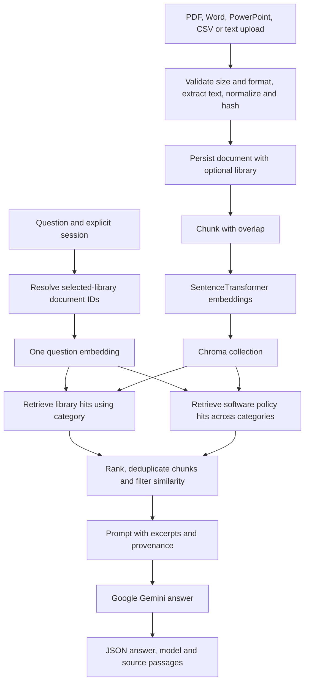

# API contracts and frontend integration

The projects run as independent applications: Next.js on localhost:3000 and FastAPI on 127.0.0.1:8002 in this workspace. `.env.local` sets the policy service URL to port 8002 because Flame RAG services occupy ports 8000 and 8001. Start the backend with `--host 127.0.0.1 --port 8002`; its default CLI port remains 8000. No workspace/monorepo, Python import from frontend, or shared build is introduced.

## Structure and libraries

Frontend: `app/` App Router routes; `components/{landing,shell,dashboard,library,chat}` feature compositions; `components/ui` installed shadcn/Radix and owner-provided controls; `lib/api.ts` HTTP adapters, `lib/api-contracts.ts` strict wire DTOs, `lib/types.ts` UI models. Runtime packages include React/Next, Tailwind 4, Radix, next-themes, Lucide, motion, metal-fx and border-beam. Existing semantic tokens, fonts and motion preferences are preserved.

Backend: `api/main.py` routing/lifespan/CORS, `api/routes` health/query/documents/libraries/sessions, `api/schemas.py` Pydantic contracts, `api/dependencies.py` pipeline and admin key, `api/db` SQLAlchemy persistence/migrations/repository, `api/services/ingestion.py` validation/indexing, `rag/` chunking/embeddings/Chroma/retrieval/augmentation/Gemini, `settings.py` environment settings. FastAPI, Pydantic, SQLAlchemy/Psycopg, Chroma, SentenceTransformers/Torch and google-genai supply the active path. LangChain and OpenAI are installed but are not the active generation flow.

## Request conventions

All table paths except health/schema/docs have `/api/v1` prefix. Browser calls use `/api/policy` and the allowlisted proxy translates paths. JSON mutation bodies use `Content-Type: application/json`. Admin writes require backend `X-API-Key`; the proxy supplies the server-only environment key. Sessions and query have no backend admin dependency, but the proxy still checks their local mutation origins.

Pagination: `limit: integer = 20` (1–100), `offset: integer = 0` (at least 0). List responses have `{total, items}`. The adapter pages lists where screens need all records, while document management can request explicit pages. Resource IDs are backend integers; UI library IDs are stringified integers, never mock slugs.

Document browsing and assignment request `limit=3` and advance offsets in
three-document steps. Filter changes reset the page; list changes clamp a final
page whose items have been removed. The backend default remains unchanged.
The category filter composes shadcn InputGroupInput with its Apply button.
Chat's compact toolbar and session management use shadcn Select for choices;
chat view selection uses ToggleGroup and secondary actions use DropdownMenu.
Keyboard and touch selection retain the same session IDs and URL behavior.

| Method and path | Params/body | Response and use |
| --- | --- | --- |
| GET `/` | None | `{status,message}`; `getServiceInfo()` maps proxy `root` |
| GET `/health` (no prefix) | None | `HealthOut`; dashboard connection/document/index counts; 503 if DB degraded |
| GET `/openapi.json` (no prefix) | None | OpenAPI object; `getOpenApi()` and contract documentation |
| GET `/libraries` | Pagination | `LibraryList`; dashboard/sidebar/session choices |
| POST `/libraries` | `{name}` trimmed 1–255 chars | 201 `LibraryOut`; create wizard; admin |
| GET `/libraries/{library_id}` | Integer path | `LibraryOut`; chat/document manager; 404 missing |
| PATCH `/libraries/{library_id}` | `{name}` | `LibraryOut`; rename dialog; admin |
| DELETE `/libraries/{library_id}` | Integer path | 204; keep documents unassigned, clear existing sessions' library; admin |
| GET `/libraries/{library_id}/documents` | Pagination, optional `category` | `DocumentList`; scoped document manager |
| POST `/libraries/{library_id}/documents` | `{document_ids:[integer,...]}` | `DocumentList` of affected docs; atomic assignment/move; admin |
| DELETE `/libraries/{library_id}/documents` | Same JSON body | `DocumentList` of removed memberships; retains documents; admin |
| DELETE `/libraries/{library_id}/documents/{doc_id}` | Integer paths | 204; single membership removal; admin |
| GET `/documents` | Pagination; optional `category`, `library_id>=1`, `uncategorized=false` | `DocumentList`; corpus browser; library and uncategorized together give 422 |
| POST `/documents/upload` | Multipart repeated `files`, `category=general`, optional `library_id>=1` | 201 if any indexed, otherwise 200 `UploadResponse`; real file handles; admin |
| GET `/documents/upload-options` | None | Available `supported_extensions`, `max_upload_bytes`, `max_files_per_upload`, `max_extracted_chars`; public |
| GET `/documents/{doc_id}` | Integer path | `DocumentDetail`; full source/content viewer |
| DELETE `/documents/{doc_id}` | Integer path | 204; permanent DB and vector deletion, explicit confirmation; admin |
| GET `/sessions` | Pagination | `SessionList`; session manager/history selection |
| POST `/sessions` | `{library_id:integer>=1}` | 201 `SessionOut`; chat/session creation |
| GET `/sessions/{session_id}` | Integer path | `SessionOut`; validate/reopen selection |
| PATCH `/sessions/{session_id}` | `{library_id:integer>=1}` | `SessionOut`; session library reassignment |
| DELETE `/sessions/{session_id}` | Integer path | 204; delete session/local browser transcript |
| POST `/query` | `QueryRequest` below | `QueryResponse`; complete JSON answer and actual citations |

`document_ids` accepts 1–1000 unique positive integers. Missing documents or documents outside the selected library give 404 without partially applying membership changes. Assignment moves uploaded documents from a previous library; each document belongs to at most one library. Seeded policies belong to the built-in Software policy library and cannot be moved, removed, or deleted through these APIs. Rename, deletion, upload and membership mutations on the built-in library return 403, including mixed assignment batches containing a protected policy; these batches do not partially apply.

## Wire response fields

- `LibraryOut`: `id:number`, `name:string`, `created_at:ISO date`, `is_system:boolean`. The backend identifies the built-in library through a unique internal `system_key`, independent of its name or numeric ID. The UI maps the flag to `isSystem`, displays it first and defaults new session creation to it. No description, file list, modified timestamp or courses are persisted. UI document lists and file counts derive from document responses; UI dates display creation date.
- `DocumentOut`: `id`, `title`, `category`, `filename`, `source`, `chunk_count`, `created_at`, `library_id:number|null`. `DocumentDetail` adds `content:string`. No byte size is returned; UI mapping marks size unknown instead of displaying invented sizes.
- `UploadResponse`: `indexed:number`, `skipped:number`, `results:[{filename,status,detail,document:DocumentOut|null}]`. Status is `indexed`, `duplicate` or `rejected`. Duplicate content refers to an existing document and does not move it to the target library. UI displays the result; explicit assignment is required to move it.
- `SessionOut`: `id:number`, `library_id:number|null`, `created_at`. An orphan session can be reassigned; its queries must not expand into other libraries.
- `HealthOut`: `status`, `database:boolean`, `documents:number`, `indexed_chunks:number`.
- `QueryRequest`: trimmed `question:string` (3–1000 chars), optional nullable `session_id>=1`, `top_k` integer (1–10), `category:string`. The backend caps `top_k` to `MAX_TOP_K` (default 6) per corpus. Omitting `session_id` searches unassigned uploads plus policies. Chat always supplies an explicitly verified library session.
- `QueryResponse`: `answer:string`, `model:string`, `session_id:number|null`, `library_id:number|null`, `sources:SourceOut[]`.
- `SourceOut`: `document_id`, `title`, `category`, `chunk_id`, `similarity:number`, `excerpt:string`, `source:string` (`seed` means software policy, `upload` means uploaded document). Similarity is a retrieval score, not answer confidence. Citation numbers follow backend source order.

Uploads accept `.pdf`, `.docx`, `.doc`, `.pptx`, `.csv`, `.txt`, `.md` and `.markdown`. PDF uses `pypdf`; Word and PowerPoint use `python-docx` and `python-pptx`; legacy Word uses `antiword` with a LibreOffice fallback for short and RTF-based `.doc` files. CSV preserves each row's column labels in readable text. Text and CSV accept UTF-8 or BOM-marked UTF-16. DOCX paragraphs/tables retain reading order; PPTX includes grouped text, tables and speaker notes. Embedded images are not OCR'd. Scanned PDFs and other image-only files require OCR before upload; password-protected and damaged files are rejected per file.

`GET /documents/upload-options` is also exposed as `/api/policy/documents/upload-options`. It reports available formats (omitting `.doc` if both `antiword` and LibreOffice are absent) and server limits. Both frontend file pickers and drag/drop validation consume its extension list. Default limits are 10 files/request, 20,000,000 bytes/file and 2,000,000 extracted characters/file; environment overrides remain authoritative. Office archives are capped at 50,000,000 expanded bytes and 5,000 entries, PDFs at 1,000 pages, and legacy conversion at 30 seconds. Category normalizes lowercase and must match `[a-z0-9][a-z0-9_-]{0,49}`. Empty, oversized, invalidly encoded and unsupported documents are reported individually. The wizard retains original `File` bytes through multipart upload and handles indexed/duplicate/rejected outcomes.

`DocumentDetail.content` is normalized extracted text, also used for content hashing and indexing. The original filename remains in `DocumentOut.filename`; the original binary is not stored. Equivalent extracted text remains a duplicate even across file formats. Existing library assignment, policy protections, session scoping and query citations use the same endpoints and contracts.

Errors preserve HTTP status and FastAPI detail: 401 admin key mismatch, 403 proxy origin rejection, 404 missing resource, 422 validation, 503 unavailable DB/admin configuration/LLM, 502 unreachable upstream and 504 proxy timeout. 204 bodies are not parsed as JSON. Failed reads never return seeded mock data. Browser abort stops awaiting the request; synchronous backend inference may already be running and cannot be guaranteed to stop.

Chat validates complete query response fields and rejects empty or malformed
answers. Failed user messages carry `failure:{kind,message,status?}`, where kind
is `unavailable`, `timeout`, or `response_failed`. A round destructive badge on
the associated query exposes the reason and retry through keyboard, hover and
touch. Failure metadata is validated and retained in browser transcripts after
reload. Retry targets the original query ID and clears that query's failure for
the new attempt; it preserves other failed queries. Manual stop is unmarked.
If the service fails before it creates a session, the submitted query and badge
remain on the open page; persistence requires a backend session ID.

## RAG flow

Startup initializes/migrates the SQL database and idempotently creates the
Software policy library, attaching all existing documents with `source=seed`
even when directory seeding is disabled. Optional software-policy Markdown
seeding attaches new and duplicate policy content to this same library. The
unique system key prevents concurrent startup from creating duplicates;
additive migrations support both existing PostgreSQL and SQLite databases.
Startup then loads the embedding model and rebuilds the Chroma index from
persisted documents. Ingestion rejects duplicates by content hash; a failed
indexing attempt rolls back its document and removes partial chunks. Membership
changes affect query scope via database IDs without reindexing. Library and
policy corpora each contribute up to the capped `top_k`; policies are not
crowded out by a combined truncation. No hits returns a helpful answer without
calling the LLM. Excerpts are reference material, not model instructions.

## Local state and limits

The old frontend persisted seeded libraries and canned messages and generated fake upload progress, thought traces, tokens and decision confidence. Those behaviors have been removed from the live workspace. Backend records are authoritative for libraries/documents/sessions. Browser storage is limited to per-session transcripts and selected-session convenience state; transcripts do not sync across browsers and are not included as model conversation context.

No course, login/auth, per-user ownership, PDF/Office parsing, token streaming, model picker, reasoning-effort or chain-of-thought endpoint exists. A future backend contract is needed for those capabilities. The local proxy protects the admin secret from client bundles but provides no multi-user authorization. Application origins and the upstream API remain local in environment settings.

## Verification recorded

The integration passed the backend's 47 existing offline tests (SQLite,
real Chroma, deterministic embeddings/generation), frontend ESLint, TypeScript
and a production build. A browser check against the real services exercised 39
proxy API operations, real file uploads, document previews/category filters,
session create/detail/reassign/delete, query fields and citation rendering,
external session reassignment rejection, mobile navigation and overflow.
The separate live Gemini query returned an answer with the uploaded document
among its sources. Browser rendering checks use an explicitly deterministic
response with real source-document metadata. No browser runtime errors occurred,
and temporary libraries/documents/sessions were removed afterward.

The current local backend runs on port 8000 and the frontend environment targets
that port, matching the examples.

Final regression checks also passed actual wizard creation/indexing, session URL
selection and reload, new session URL persistence, source-menu document
navigation, mobile chat/document layout, dark theme, active-library rename and
delete from its document screen, and retained document/session records. The
browser had zero runtime errors. `scripts/verify-workspace-smoke.mjs` preserves
these checks separately from the full endpoint integration check.

The built-in policy library and query-failure update passed 75 backend tests,
11 offline frontend response/transcript checks, ESLint, TypeScript and a
production build. `scripts/verify-system-library.mjs` verified the live
PostgreSQL library backfill (28 policies), API immutability, default session
selection, read-only UI, failure persistence, retry and manual cancellation.
Controlled HTTP/network failures exercise the badge renderer. Desktop/light
and mobile/dark checks passed without runtime errors or horizontal overflow;
touch badges retain a 24px visible circle with an expanded hit area. The
existing custom-library workspace smoke check also passed.
